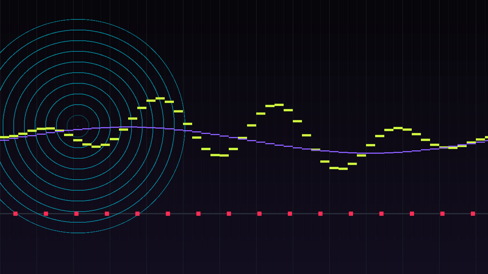
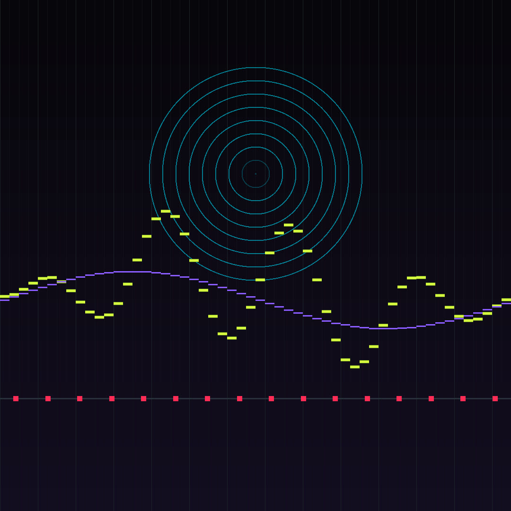
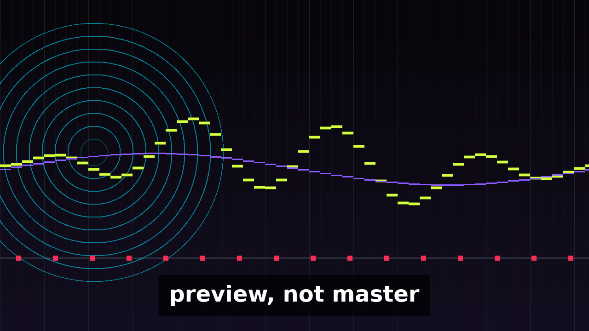

# Psy Trance Rolling Basslines

Original note-only MIDI studies of rolling monophonic basslines. Eight studies, two bass variations each. Harmonic references and kicks are cataloged separately and are not part of the core count.

- **Catalog:** https://mizcausevic-dev.github.io/psy-trance-rolling-basslines/
- **Media:** https://mizcausevic-dev.github.io/psy-trance-rolling-basslines/media.html
- **Repository:** https://github.com/mizcausevic-dev/psy-trance-rolling-basslines



## Assets

| Item | Path |
| --- | --- |
| Catalog page | [`index.html`](index.html) |
| Hero still, 1280x720 | [`art/hero.jpg`](art/hero.jpg) |
| Square still, 1080x1080 | [`art/square.jpg`](art/square.jpg) |
| Instagram portrait, 1080x1350 | [`social/instagram-Cursor/portrait.jpg`](social/instagram-Cursor/portrait.jpg) |
| X card, 1600x900 | [`social/x-Cursor/card.jpg`](social/x-Cursor/card.jpg) |
| Film poster | [`film/poster.jpg`](film/poster.jpg) |
| Music preview, MP3 | [`preview/preview.mp3`](preview/preview.mp3) |
| Film, MP4, with captions | [`film/preview.mp4`](film/preview.mp4) |
| Captions | [`film/preview.vtt`](film/preview.vtt) |
| Preview arrangement, Format 1 | [`midi/arrangement.mid`](midi/arrangement.mid) |
| Validation report | [`midi/validation-Cursor.json`](midi/validation-Cursor.json) |





The stills are procedural illustrations of a timing grid, a ring, a ribbon, and kick markers. They are not photographs.

## Studies

- s01 Downbeat Void: 140 BPM, 16 bars, A Phrygian, tonic reference A.
- s02 Offbeat Ladder: 144 BPM, 8 bars, E Phrygian dominant, tonic reference E.
- s03 Fifth Gate: 138 BPM, 16 bars, D harmonic minor, tonic reference D.
- s04 Short Gate Engine: 146 BPM, 8 bars, F# Phrygian, tonic reference F#.
- s05 Held Fifth: 142 BPM, 16 bars, G Phrygian, tonic reference G.
- s06 Five-Cell Crawl: 148 BPM, 8 bars, pitch-class set {0, 1, 3, 6, 7}, tonic reference no fixed tonic.
- s07 Question and Gap: 141 BPM, 16 bars, C Hungarian minor, tonic reference C.
- s08 Displaced Octave: 145 BPM, 8 bars, Bb natural minor, tonic reference Bb.

Core bass files: 16. Reference files: 19. Pitched notes are MIDI 28 through 60. C4 is 60. PPQ is 960. Meter is 4/4. Bass is monophonic.

Use either the combined arrangement or the separate parts. Do not stack the part files on top of the combined file.

## Preview

`preview/preview.mp3` is the primary music preview. The encoded file is 27.455 seconds. preview, not a master. The film uses that same preview. On-picture and caption text is `preview, not master`. The MP4 probe is 27.428 seconds because the film ends on a video frame.

No human listening audition was performed for this build. The sample peak in the preview manifest is not LUFS and it is not a true peak.

## Build

Python 3.11+ and ffmpeg (libmp3lame, aac, libx264):

```bash
python3 tools/build_pack.py
python3 -m http.server 41773
```

The page is static. Standard library only.
